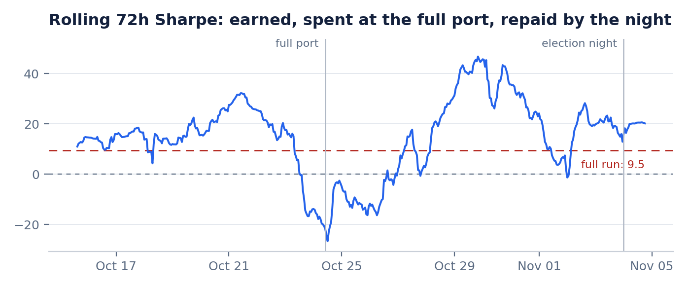
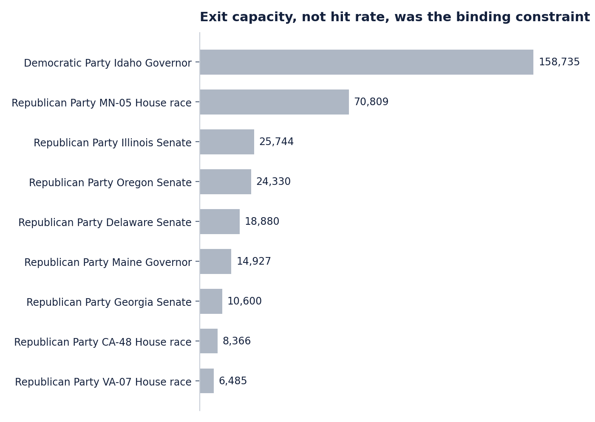
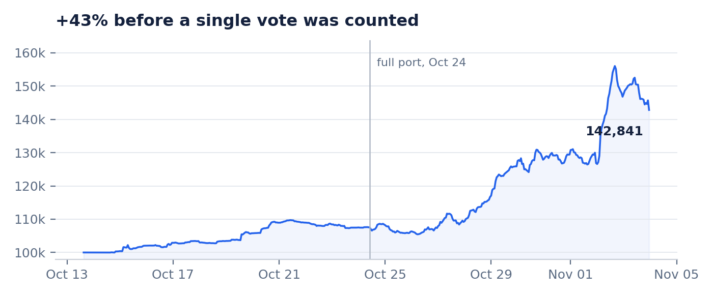
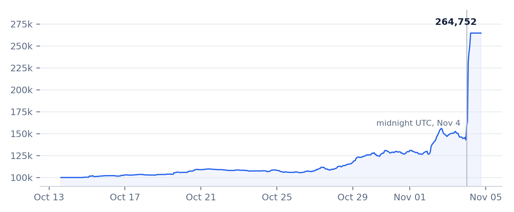

# SIG Predictions Cup: a two week bot campaign on the 2026 US midterms

Trading bots built for the Susquehanna (SIG) Predictions Cup, a public tournament on binary election markets with virtual money. Joined three weeks into the race, rebuilt the strategy twice, and finished 23rd out of 1,966 traders by maximizing the probability of a top finish instead of the account's average outcome.

> **All of this was virtual money.** The tournament runs on SUSQies, a play currency with no monetary value. Nothing here is investment advice, and none of these numbers are real world returns.

## Key results

| | |
| --- | --- |
| Tournament | Susquehanna (SIG) Predictions Cup, 2026 US midterms |
| Period | October 13 to November 4, 2026 (market freeze), trading via the official API |
| Account | `bright-dawn-4945`, starting balance 100,000 SUSQies (virtual) |
| Final balance | 264,752 SUSQies, +165% |
| Final rank | 23rd out of 1,966 traders (after settlement) |
| Trades | 1,184 |
| Infrastructure | one rented VPS (UpCloud, zone NO-SVG1, Norway), Python bots as systemd services, stateless, restart safe |

Risk adjusted, for the record: annualized Sharpe 9.54 on hourly returns and 5.84 on daily closes over the full run (computed by `src/sharpe_report.py` from the API's hourly account history; the API itself reported 8.33 with an undocumented methodology). The honest caveat: a three week Sharpe earned mostly on one winning correlated bet measures variance captured, not a repeatable edge.



Every chart in this README is computed from the raw CSV files in `data/` by `src/make_charts.py`; the committed PNGs are that script's output, nothing is hand drawn or hard coded.

## The story

### Joining a race already underway

The Predictions Cup prices every midterm race (Senate, governors, House) as a binary contract between 0 and 1, with an official API and bots explicitly allowed on a single account. Only the very top of the leaderboard wins prizes. I entered on October 13 with the leaders weeks ahead, third place already pulling away toward +790,000 while a fresh account started at zero P&L.

Strategy 1 was systematic and prudent: four market making bots on disjoint contract sets, all anchored on one indicator, each contract's 7 day hourly median price, used as a flow neutral fair value proxy. A ladder of resting bids below that median on extreme longshots, passive mean reversion on contested races, the ladder logic concentrated on the most volatile longshots, and a fixed grid on lopsided races. Their shared thesis, which held up in the data: this market's volatility comes from participant flow, not news, so you can be the patient side of other players' impatience.

By October 16 the verdict was in: +1.6%, rank 353. A good Sharpe, a hopeless trajectory.

### Changing the objective function, then measuring

The turnaround started from tournament math, not from a market view. In a winner take all format the expected value to maximize is the prize, and the prize is a step function of rank: EV = P(reaching the top) x prize money. Maximizing EV therefore means maximizing P(top), even at the cost of the account's average balance. Kelly sizing on the balance no longer applies, and a high probability of ruin becomes acceptable if it buys a fatter right tail. With no leverage on the platform, a multiple can only come from cheap contracts that rally hard, or from compounded wins.

Before writing any trading code, I measured. A read only scan (results in `data/turbo_scan_results.csv`) replayed a simple cycle on every contract priced between 2% and 35%: rest a bid at 0.6x the 7 day median, sell at 1.5x the entry. Over the first weeks of the tournament that cycle had won 83 times out of 84, with a median holding time of 10.5 hours per contract. The same scan exposed the real constraint: the sellable volume per cycle exceeded 5,000 SUSQies on only 9 contracts. The edge was huge, the size was capped.



A dedicated bot ("turbo") industrialized that cycle for one day, with per contract size calibrated to the measured exit capacity, and paid about +6,000 in 24 hours. In parallel a live dashboard went up on the server (`src/dashboard.py`): account value and rank, a progress bar toward third place's P&L, rolling 72h Sharpe, basket fill rate, settlement scenarios recomputed every minute, and bot health.

### The full port

Turbo's ceiling was the problem: capacity capped its realistic gain at tens of thousands by election day, nowhere near a podium above +800,000. One last edge hypothesis was checked and discarded: the gap between tournament prices and real money venues, 8 points on Senate control in mid October, had closed to 1 or 2 points. No information edge left. But variance is free when only rank matters: outside the top, a 50k account and a 100k account are worth exactly the same.

So on October 24 the entire account went into one correlated directional bet: a basket of 8 same side contracts priced between 0.20 and 0.44 (Iowa, Kansas, South Carolina and Nebraska Senate races, Texas, Florida, Kansas and Vermont governor races). The basket's logic: polling errors are national, so these races win and lose together, which fattens both tails, and the right tail is the only one that counts.

`src/basket_bot.py` executed it with three rules. Slippage free tranche buying: each round it takes only the quantity shown at the best offer, never above the entry reference plus 10%, so it never chases. Laddered sells posted at entry: half at 2x the average cost, half at 3x (5x below 0.20), capped at 0.95, so every spike is monetized without waiting for resolution. Per contract budget of one eighth of the account, recomputed continuously, so gains reinvest themselves.

### Hardening for election night

In pure hold to resolution the probability of losing the whole basket came out around 10%: roughly 3% from the product of prices, the rest from the common national polling error factor. Three safeguards brought ruin down to an operational risk below 1%:

* a rescue: full market sale of any position whose best bid drops below 50% of its average cost, armed an hour before counting starts;
* an absolute floor at 0.10, independent of average cost, for positions whose average had been moved around by intraday sales;
* East to West rolling during the count: with poll closings staggered over two hours, Eastern races reveal the national direction first, so the cash from every sale is continuously reinvested into basket contracts still below 0.80, below 1.5x their pre count price, and whose bid holds at 80% of that price (never roll into a race that is losing), cheapest first, at most 35% of the account per contract.

Partial de risking (selling half before the night) was considered and rejected: in a winner take all tournament, half a stake halves the only thing that counts.



By election eve the account was up 46% without a single vote counted: turbo's cycles, the disciplined basket build, and the market re rating the basket.

### Election night

Everything settled between 1:00 and 1:17 am Paris time (midnight UTC on November 4). As Eastern polls closed, prices jumped at once; the laddered targets unloaded seven of the eight races between 0.50 and 0.95, the rolling logic turned over the last entries (bought at midnight, sold at 0.93 to 0.95 within the quarter hour), and the one losing race, Florida governor, was evacuated by the absolute floor: 55,720 shares sold at 0.10 instead of riding to zero. By late morning the account held zero positions and 264,752 in cash, locked in seven hours before the market froze.



## What worked

* **Changing the objective function.** Every pivot (dropping the four v1 bots, dropping turbo, rejecting partial de risking) follows from one principle set on October 22: maximize P(top), not the average balance.
* **Measuring before coding.** The scan turned an intuition into parameters and exposed the binding constraint (exit capacity) that intuition had missed.
* **Safeguards written in cold blood.** The 0.10 floor, added five days before the night out of pure scenario analysis, was the sole trigger of the night's only rescue.
* **Stateless bots as systemd services.** Every round re reads true state from the API; a server migration mid tournament and three strategy rewrites never lost an order or doubled a position.

## What failed

* **An unverified patch is an absent patch.** A final tweak (raising the low sell legs to a 0.70 floor, to sell confirmation rather than mid river) was validated in simulation the day before the election and never actually deployed to the server; the post deploy check was skipped. Estimated cost: 15 to 20 thousand SUSQies of sell proceeds. Fixed after the fact in `src/basket_bot.py` (`NIGHT_SELL_FLOOR`, active from the guard window), and the bot now prints its night settings at every start so a deploy can be checked from the log.
* **The rolling filter bought into a collapse once.** Eight minutes before the Florida rescue, the rolling logic bought that contract back at 0.175 on the way down, because the first leg of the drop had already lowered the pre count reference that serves as its filter. Small loss, real design flaw: the momentum guard should compare against a frozen pre count price, not a rolling one. Fixed after the fact: the bot now snapshots each basket contract's quote during the last pre count hour, freezes it at the start of the count and saves it to `precount_refs.json`, so neither a later price nor a restart can move it.
* **A cash accounting bug hid in plain sight** until the account was fully invested: cash was computed as equity minus cost basis, so unrealized gains looked spendable and buys bounced off the API. One line fix (`cash = equity - market value`).

## Honest limitations

* This was virtual money in a closed tournament with a single market maker; fills, depth and behavior do not transfer to real venues.
* The directional basket had no information edge, by construction and by measurement; the payoff is variance that happened to land on the right side. The process (sizing, exits, safeguards) is the transferable part, not the outcome.
* The Sharpe figures cover three weeks dominated by one bet; they are reported for completeness, not as a repeatable statistic.
* The 10% ruin estimate rests on a hand built national error factor model, not on a fitted copula.

## Repository layout

```
data/
  account_history_hourly.csv   hourly account value, Oct 13 to the Nov 4 freeze (tournament API)
  turbo_scan_results.csv       the read only scan: cycle stats and exit capacity per contract
src/
  basket_bot.py                the final strategy: basket build, laddered exits, rescue, night rolling
  dashboard.py                 live HTML dashboard served from the trading server
  make_charts.py               regenerates every chart of this README from data/ (nothing hard coded)
  sharpe_report.py             full run Sharpe from the API's hourly history
  export_history.py            dumps the hourly account history as CSV (how data/ was produced)
deploy/
  basket-bot.service           systemd unit for the bot
  dashboard.service            systemd unit for the dashboard
  predictions-cup.env.example  environment file template (API key)
  deploy.sh                    copy to the server, restart, then run the post deploy check
  post_deploy_check.py         proves the deployed code is the code running (see below)
tests/
  test_price_rules.py          unit tests of the bot's price and sizing rules, on a fake API
  test_scan_replay.py          replay of the scan CSV: README figures, invariants, bot on the scan's books
  test_post_deploy_check.py    the post deploy check on a fake server tree
```

The four v1 market making bots and the one day turbo bot also ran during the campaign; their source is not included in this repository.

## Reusing the execution logic elsewhere: `basket_exec`

`src/basket_bot.py` is kept as it ran. Its execution rules now also live in `basket_exec/`, a small library with no tournament in it, so the same process can run on another venue:

```
basket_exec/
  engine.py                 plan_round(): one pure function, account snapshot in, orders to cancel and place out
  config.py                 every parameter; Config.sig_cup() reproduces the tournament bot
  runner.py                 the stateless round (read, plan, execute), simulation by default, and the Venue interface
  adapters/supermarket.py   the tournament API, kept as the reference adapter
  adapters/polymarket.py    the Polymarket CLOB (real money)
examples/polymarket_basket.yaml
tests/                      python -m pytest tests
```

What carries over unchanged: tranche buys that take only the size shown at the best offer and never pay more than the reference plus 10%; the sell ladder (half at 2x the average cost, half at 3x, 5x below 0.20, capped at 0.95); the rescue at the greater of 50% of the average cost and 0.10; the sell floor once the guard is armed (`guard_sell_floor`, 0.70 in the tournament); the rolling window with its pre window reference snapshotted, frozen at the start of the window and saved to a file so a restart cannot move it; and cash accounting where budgets are a share of equity but only real cash, net of resting buys and of the reserve, can be spent. `tests/test_parity.py` feeds 1,200 random account states to both the bot and the library and checks they decide the same orders, then replays the Florida case (prices and history dropping after the window opens, then a restart) on both.

What is new, because a real wallet is not a tournament account:

* Positions and orders outside the basket are left alone unless `cleanup_outside` is set. The tournament bot sold everything else on the account.
* `max_capital` sizes the basket on a fixed amount instead of the whole wallet.
* Tick size, minimum order size and minimum buy value are per instrument. A ladder leg too small for the venue is merged into the low leg.
* The rescue can be armed while the basket is still being built (`guard_from`). In that case a collapsed instrument is not bought back.
* On Polymarket, quantities come from the CLOB token balance and cash from the USDC balance; the Data API only supplies the average cost.

```
POLYMARKET_FUNDER=0x... python -m basket_exec --config examples/polymarket_basket.yaml          # dry run, sends nothing
POLYMARKET_FUNDER=0x... POLYMARKET_PRIVATE_KEY=... python -m basket_exec --config ... --live    # real orders
python -m basket_exec --config ... --live --stop                                                # cancel the basket's orders
```

The Polymarket adapter is tested against canned API payloads only. It has not yet placed a real order: run it in dry run first, then live with a small `max_capital`. The honest limitations above still apply, and this is not investment advice.

## Recording Polymarket order books: `book_recorder`

Polymarket keeps no order book history, and the Smart pod's research (impact after a book sweep, wallet metaorders, book imbalance) needs one. `book_recorder/` records it on the server, with no key and no wallet:

```
python -m book_recorder markets                         # the 100 markets it would follow now
python -m book_recorder record --out /var/lib/book-recorder   # the service (deploy/book-recorder.service)
python -m book_recorder trades --out /var/lib/book-recorder   # daily, trades with wallets (deploy/book-trades.timer)
python -m book_recorder stats /var/lib/book-recorder/book/2026-11-19.jsonl.gz
```

* Websocket market channel, the 100 most active markets by 24h volume (markets ending within 24 hours and books under 1,000 USDC of liquidity are skipped), 50 tokens per connection, reconnect with backoff, silent connections dropped after 2 minutes.
* `book/<UTC day>.jsonl.gz`: every message exactly as received with its receive time, plus open/close markers so gaps are visible. The set is re-selected at midnight UTC with new connections opened before the old ones close, so each day file starts with full snapshots and can be replayed alone. `markets/<day>.json` lists the markets in force.
* Polymarket resends a token's whole book after every trade. The first book of the day per connection and one every 10 minutes are kept as received; the others are stored as the levels that changed, without loss (`book_recorder/compact.py`), and replay rebuilds them.
* `book/` is kept under 12 GB (`--max-gb`) by deleting the oldest days.
* `trades/<condition id>.jsonl.gz`: Data API v2 trades (`condition=` filter, newest first, cursor pages), incremental, raw rows kept without the profile fields.
* `book_recorder.replay` rebuilds L2 books and the trade tape from the files.
* Below 2 GB of free disk recording pauses instead of filling the disk.

Install on the server after `git pull`: `sudo deploy/install_book_recorder.sh`.

## Reproducing

The charts need only Python 3.11+ and the pinned requirements:

```
pip install -r requirements.txt
python3 src/make_charts.py        # writes 4 PNG files to charts/
```

The bots and reports talk to the tournament API and need a key in the environment (`cp deploy/predictions-cup.env.example` and fill it in). The tournament ended on November 4, 2026, so they are published as a record of what ran, not as something to point at a live market:

```
export SUPERMARKET_API_KEY=...
python3 src/basket_bot.py         # one simulated round, no orders sent
python3 src/basket_bot.py --live  # what actually ran, as a systemd service
```

## Tests and the post deploy check

```
pip install -r requirements-dev.txt
python3 -m pytest -q tests
```

The tests need no API key and no network: the bot runs against an in memory fake of the tournament API. They pin every price and sizing rule to numbers (tick rounding, the 2x/3x/5x ladder and its 0.95 cap, the rescue at 50 percent of cost and the 0.10 floor, the reference plus 10 percent cap, per contract budgets, cash computed from market value, night caps and the drop guard), recompute every figure this README quotes from `data/turbo_scan_results.csv`, and replay the bot on the order books that scan recorded. GitHub Actions runs them on every push.

`deploy/deploy.sh user@server` is the answer to the unverified patch above: it refuses to deploy uncommitted code, copies `src/` and `deploy/`, restarts both services, then runs `deploy/post_deploy_check.py` on the server. The check fails unless the deployed files hash to the commit being deployed, the installed systemd units match `deploy/`, each service started after its code last changed, the bot logged a LIVE start and a `Round OK` with no round error since the restart, and the dashboard answers HTTP 200.

## Disclaimer

Personal project, virtual currency only, no affiliation with Susquehanna International Group beyond participating in their public tournament. Not investment advice.
